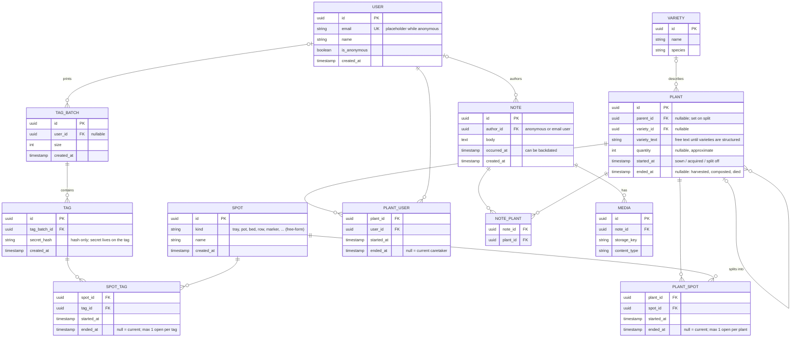

# Domain Model

Status: **draft**. Sources: [concept sketch](ideas/2026-11-05-plantbook-concept.jpg), [idea dump](ideas/2026-11-06-dump.md). URLs: [decision 001](decisions/001-url-namespace.md).

## Vocabulary

Where possible, the word the gardener sees and the name in the code are the same. Where they differ, the user-facing word describes an action and the technical side says how it's stored.

| User-facing | Technical | Meaning |
|---|---|---|
| **Tag** | `tag` | A physical QR label (sticker, plant marker). It holds a secret and is assigned later. Whoever holds it can edit what it's attached to. |
| **Spot** | `spot` | Whatever a tag is attached to: the unit that makes sense to the gardener. A tray, pot, egg carton, planter, a row in the vegetable plot, the place next to the rhubarb. Free-form `kind` + `name`. |
| **Plant** / **Plants** | `plant` | One or more plants of the same kind that share a history from some point on: "12 Yellow Pear tomatoes", "the rhubarb". Has an optional, approximate `quantity`. |
| **Note** | `note` | Text and/or photos on a timeline, about one or more plants. |
| **Gardener** | `user` | Anyone who writes. Starts anonymous (per browser); an email makes it last. See [decision 003](decisions/003-identity.md). |
| *(tagged)* | `spot_tag` row | Tag is on a spot, from when to when. |
| *"in this tray since …"* | `plant_spot` row | Plant lives in a spot, from when to when. |
| **Caretaker** / *"cared for by"* | `plant_user` row | User looks after a plant, from when to when. |
| **Move** | end one `plant_spot` row, start another | All of a plant goes to another spot. It stays the same `plant`. |
| **Split** / **Divide** / **Transplant some** | new `plant` with `parent_id` + its first `plant_spot` row | Part of a plant goes elsewhere, which creates a child plant. Can be partial: the parent continues with the rest. Dividing the rhubarb into 4 = 4 children (or 3 + the parent continuing). |
| **Give away** | end the `plant_user` row | The giver lets go of the plant. Naming the receiver is optional. |
| **Adopt** | start a `plant_user` row | Someone scans a released (or never-claimed) plant's tag while logged in and adds it to their account. |
| **Tag sheet** | `tag_batch` | One print run of tags. Also where selling tag sets would fit later. |
| **Variety** | `variety` | What the plant is ("Yellow Pear tomato"). Starts as free text on `plant`. |
| **Photo** | `media` | Image attached to a note. |
| **Timeline** | *(derived)* | See [Timeline](#timeline). |

**Why "Spot":** it covers a pot, a seed tray and a row of carrots without suggesting any one of them. "Container" leaves out beds and rows. "Location" sounds like GPS coordinates. Alternatives considered: Home (clashes with the homepage), Place, Bed, Planting.

**Why "Plant" for a group:** gardeners say "my tomatoes" for a tray of 12 seedlings. `quantity` and the variety name are enough to show "Yellow Pear tomatoes (12)", without a separate "Batch" concept.

## Entities

### Core
`tag`, `spot`, `note`, `plant`, `user`: the story itself.

### Join tables
Naming convention: **the two table names in singular, in alphabetical order, joined with `_`**. The name describes *which tables* are connected, not *what the connection means*. The meaning lives in the vocabulary above and in the UI.

| Join table | Connects | Time window | At any moment |
|---|---|---|---|
| `spot_tag` | spot ↔ tag | `started_at` / `ended_at` | a tag is on at most 1 spot |
| `plant_spot` | plant ↔ spot | `started_at` / `ended_at` | a plant is in exactly 1 spot |
| `plant_user` | plant ↔ user | `started_at` / `ended_at` | a plant has at most 1 caretaker |
| `note_plant` | note ↔ plant | – | – |

**Why these are join tables at all:** at any single moment, the first three are one-to-many. Over time they become many-to-many: the marker moves, the tomatoes get transplanted, the plant gets given away. Since the timeline *is* the product, history is the primary data and "now" is the row where `ended_at` is null.

The "at any moment" column is enforced in the database:
- **Postgres partial unique index**, e.g. `UNIQUE (plant_id) WHERE ended_at IS NULL`.
- **Exclusion constraint** on the time range, so past windows can't overlap.
- **A "current" view** per join table makes everyday queries feel like a plain one-to-many.

If a future relationship between the same two tables appears (e.g. users *following* plants), `plant_user` gets a `role` column instead of a second table.

Not a join table: `plant.parent_id`. A split gives each child exactly one parent, so it's a self-reference.

### Supporting
`tag_batch` (print runs), `variety` (what a plant is), `media` (photos).

## ERD

## Timeline

A timeline merges two sources:

**1. Events derived from the structure.** These aren't stored as notes: the join tables and plant rows are the single source of truth.

| Timeline item | Derived from |
|---|---|
| Sown / acquired | `plant.started_at` (+ first `plant_spot` row) |
| Moved to *spot* | a `plant_spot` row starting |
| Split off from *parent* / *n* split off | a child `plant` with `parent_id`, `started_at` |
| Given away / adopted by *gardener* | a `plant_user` row ending / starting |
| Tagged | a `spot_tag` row starting |
| Harvested / ended | `plant.ended_at` |

**2. Notes.** Text and/or photos written by a person. No `kind` column yet. A note written during a structural event (the handover photo with giver, receiver and plants) shares its timestamp and is shown next to that event.

Care actions (watered, fertilised), observations (germinated, first flower) and harvest amounts stay plain notes until we want to *query* them, e.g. "days from sowing to germination" for the journaling and learning goal. When that happens, we add a nullable `kind` + `data` without disturbing existing notes.

**What a timeline includes:**
- **Plant:** notes mentioning the plant (`note_plant`) + derived events for the plant + the same for its **ancestors**, up to each split. A transplanted tomato shows the tray history it was part of, but not the pepper-only notes.
- **Spot:** notes about plants while they were there + `plant_spot` and `spot_tag` events ("tomatoes here from X to Y").
- **Tag:** no timeline. Scanning opens its current spot. If it isn't attached, scanning starts the "what is this tag for?" flow.

## Access rules

- All plant and spot pages are **publicly readable**.
- Holding a **tag secret** gives edit rights to the tag's current spot and the plants currently in it.
- A **caretaker** (open `plant_user` row) can edit their plants without scanning.
- Unowned plant + tag scanned → offer to **adopt**, and suggest adding an email so the plant isn't lost with the browser.
- Escape hatch (later): the caretaker can make a plant read-only by default. Only caretakers will be able to make edits.
